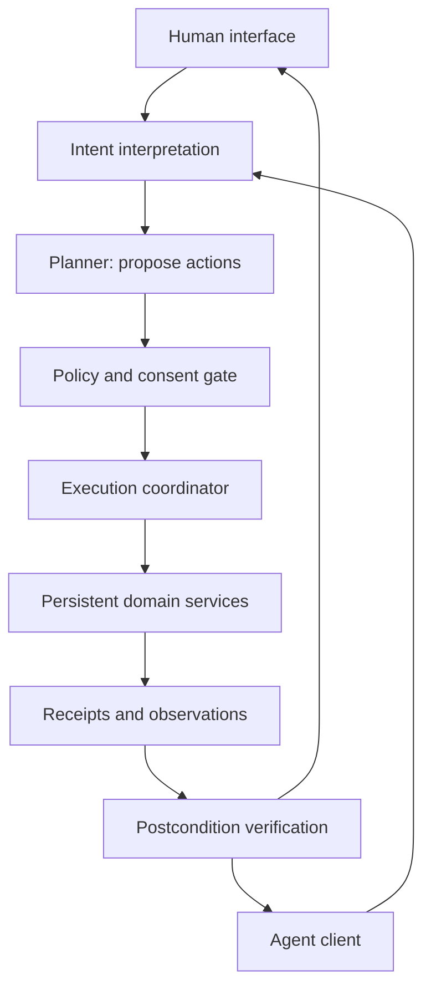

# Intent-Native Software

### A thesis on persistent capabilities, adaptive interfaces, and the agent-accessible internet

**Harry Henry Hanrui Wang · Founder, Walify**

**Status:** public position paper and research agenda. The architecture below is a proposal, not a description of Walify's deployed systems. This repository began as a GitHub workflow sandbox and now develops the thesis in public.

## Abstract

The application is a convenient distribution boundary, but often an inconvenient execution boundary. A task such as organizing an evening crosses calendars, messages, reservations, and payments, while the user must repeatedly translate the same intention into each application's interaction model.

This paper proposes **intent-native software**: an architecture in which persistent domain services expose typed, permissioned capabilities, while human interfaces and AI agents become alternative clients of those capabilities. The proposed shift is from navigating isolated application surfaces toward composing verifiable state transitions across services.

The difficult part is preserving authority, meaning, and recoverability when a probabilistic planner coordinates durable effects. An adaptive interface can be ephemeral; identity, consent, and transaction history cannot be.

## 1. The interface is a projection; the service is the substrate

A useful decomposition is:

\[
\text{Software experience} = \text{persistent state} + \text{capability contracts} + \text{interaction projection}
\]

The projection might be a mobile app, a generated form, a conversational turn, or an agent tool call. Multiple projections should share domain semantics and authorization rules. A calendar entry created through conversation should remain inspectable and editable through a conventional interface.

This does not imply that every interface should be generated. Stable spatial interfaces remain valuable for expert work, comparison, exploration, and accessibility. The thesis predicts that the coupling between a service and a single primary interface will weaken.

## 2. From commands to constrained intent

Natural language is an input modality, not an executable specification. Represent an interpreted intent as:

\[
I = (G, C, A, E)
\]

- **G — goal:** a proposed target condition over observable state.
- **C — constraints:** time, cost, privacy, and domain restrictions.
- **A — authority:** actions and resources the principal has delegated.
- **E — evidence:** observations required before declaring success.

For “organize dinner on Friday,” the goal may be a confirmed booking for four people; constraints include a time window and budget. Authority might permit searching and drafting, while requiring approval before a reservation. Evidence is the provider's booking record, rather than the planner's assertion that it succeeded.

A planner proposes a policy \(\pi\) under partial observability. The runtime admits only actions whose contract preconditions and authorization predicates hold. Planner output is a candidate program, not a source of permission.

## 3. Capabilities as effectful contracts

Define a capability as:

\[
K = (X, Y, P, Q, F, V)
\]

Here \(X\) and \(Y\) are input and output types; \(P\) is the precondition; \(Q\) describes the promised postcondition on success; \(F\) declares effects; and \(V\) identifies the contract version. The runtime must also represent failure and indeterminate outcomes explicitly.

An effect declaration must distinguish reading information, changing private state, communicating externally, and incurring financial obligations. A valid JSON response proves structural conformance only. It does not prove that an appointment exists or that a recipient received a message.

Composability requires more than matching output fields to input fields. Two services can both use a field called `time` while disagreeing on timezone, precision, or whether it denotes arrival or departure. Structural typing must be complemented by domain semantics, units, provenance, and version negotiation.

## 4. A reference architecture

The diagram shows a logical data path. Untrusted service output must not modify policy, issue delegation grants, or become higher-priority instructions. Every external effect passes through the gate, including retries and recovery operations.

Three boundaries matter:

1. **Interpretation → authorization:** understanding what a user might want does not establish permission to do it.
2. **Authorization → execution:** approval binds to concrete parameters, recipients, scope, and expiry; material changes require renewed approval.
3. **Execution → verification:** a successful invocation is distinct from evidence that the intended state was reached.

See [Execution semantics](docs/execution-semantics.md) for the proposed lifecycle and [Research agenda](docs/research-agenda.md) for ways to test the thesis.

## 5. The internet as a graph of invocable capabilities

The web makes documents addressable. APIs make operations callable. Agent-accessible software additionally needs operations to be discoverable, semantically legible, permissioned, and verifiable across organizational boundaries.

Model this as a changing graph \(\mathcal{G}_t=(\mathcal{K}_t,\mathcal{E}_t)\), where nodes are capability contracts and edges represent admissible compositions. An edge is conditional on compatible semantics, identity, authority, and current state. A catalog of tool descriptions alone is not such a graph.

The architectural hypothesis is that more workflows will be assembled over this graph at execution time. Services could be discovered through an intent rather than an app-store search, while durable identity and reputation remain attached to the service provider. Interfaces become contextual entry points into a persistent service economy.

This is a possible direction, not an inevitable replacement for applications. Discovery quality, liability, provider incentives, interoperability, and user trust may limit it.

## 6. Where value could move

If assembling an interface becomes inexpensive, defensibility may shift toward trusted state, distribution, specialized workflows, domain expertise, and permission to act. Cheap interface generation does not make reliable services cheap: integrations, moderation, support, and external obligations remain costly.

One possible equilibrium is a small number of intent-routing platforms. Another is an interoperable ecosystem of independently operated services. The first may lower integration friction while concentrating discovery and identity. The second requires stronger shared contracts and credible portability. Technical interoperability alone does not decide the economic outcome.

## 7. The Walify connection

The direction I want to explore with Walify is a low-friction environment in which people and AI agents can use software services. Consumer mobile experiences are the opening context for that thesis; broader creator, business, and community participation is a longer-term possibility.

This paper describes the architectural questions behind that direction. It makes no claim that Walify currently implements the contracts, runtime, interoperability, or economic model proposed here. It contains no internal endpoints, credentials, infrastructure details, private metrics, or unpublished implementation plans.

## 8. What would make this thesis wrong?

- Explicit capability contracts might cost more to maintain than the workflow value they unlock.
- Agent-mediated interaction might reduce users' understanding and control enough to cancel its convenience.
- Cross-service coordination might remain too brittle for consequential tasks even as models improve.
- Most valuable workflows might stay inside vertically integrated applications with superior domain context.
- Users might prefer stable interfaces even when adaptive alternatives achieve comparable reliability.

The thesis is useful only if it survives comparisons against strong conventional software, not just against inconvenient demonstrations.

## Reading map

| Document | Question |
|---|---|
| [Execution semantics](docs/execution-semantics.md) | How can uncertain planning interact with durable effects? |
| [Research agenda](docs/research-agenda.md) | Which experiments would support or weaken these claims? |
| [References](REFERENCES.md) | Which established ideas does this proposal build on? |

This repository is a conceptual essay, not a benchmark, protocol standard, or implementation. No experimental results are claimed.
