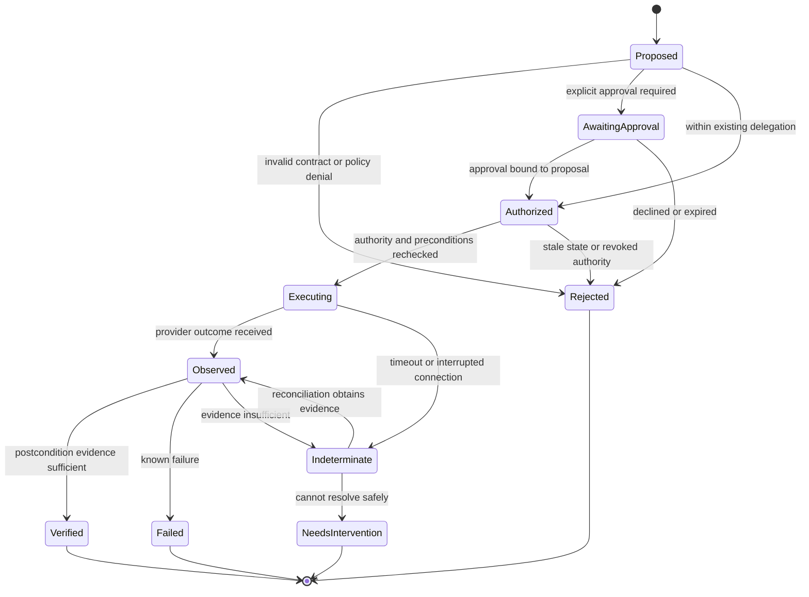

# Execution semantics for probabilistic planners

**Design proposal.** These are requirements for a possible runtime, not verified properties of an implemented system.

## State machine

An unresolved outcome is a first-class state. It must not silently become either “failed, retry” or “succeeded, tell the user.”

## Authority is bound to an operation

Let a grant contain a principal, operation, resource scope, parameter constraints, expiry, and consumption rule. The admission predicate is conceptually:

\[
\operatorname{admit}(a,g,s,t) =
\operatorname{authenticated}(g)
\land \operatorname{scoped}(a,g)
\land \operatorname{fresh}(g,t)
\land \operatorname{precondition}(a,s)
\land \operatorname{available}(g)
\]

For a single-use approval, reserving or consuming the grant and recording the operation must be atomic within the coordinator's storage boundary. Consumption creates a durable authorization binding to that operation, not permission for another operation. Redispatch can use that binding only for the identical request, while its scope, expiry, and revocation checks still pass, and while duplicate suppression or authoritative no-effect evidence makes repeating it safe. Otherwise renewed authority or intervention is required. A local transaction cannot atomically include an arbitrary remote provider. That gap requires reconciliation, not stronger wording in the grant.

Canonical parameter binding must be specified before hashes are used: equivalent JSON encodings must not produce accidental mismatches, and mutable references must not change meaning after approval. A hash binds bytes; it does not establish human comprehension or semantic equivalence.

## Proposed invariants

| Invariant | Consequence |
|---|---|
| All external writes require valid authority at dispatch | A plan cannot authorize itself. |
| Reads and retrieved content cannot mint authority | A document cannot grant permission through embedded instructions. |
| Approval binds to the reviewed operation | Changed recipients, prices, or scope invalidate approval. |
| Retries preserve operation identity | A network retry must not be treated as a new approved purchase. |
| Verified success requires domain evidence | A natural-language completion claim is insufficient. |
| Unknown outcomes remain visible | A timeout is not proof that nothing happened. |

These are review targets. Proving them requires an implementation, a trust model, and adversarial tests.

## Delivery semantics and the retry trap

Suppose a provider completes a reservation but its response is lost. Retrying may create a second reservation; refusing to retry may leave the user uncertain.

A practical coordinator should persist an operation identifier before dispatch, use provider-supported idempotency where available, and query provider state before repeating an ambiguous effect. An eventually consistent “not found” response is not authoritative evidence that nothing happened. If neither a valid duplicate-suppression guarantee nor authoritative no-effect evidence is available, do not redispatch: retain the unresolved outcome and require intervention. The same key with a changed request must be rejected. Retention windows and provider behavior must be documented.

HTTP defines idempotence in terms of the intended server effect of repeated identical requests. It does not establish exactly-once execution of an arbitrary business workflow. A `POST` request needs an application-level contract if duplicate suppression is required. See [RFC 9110 §9.2.2](https://www.rfc-editor.org/rfc/rfc9110.html#section-9.2.2).

## Multi-service workflows are not one transaction

Booking a table, sending invitations, and paying a deposit cross separate authority and failure domains. If the invitation fails after payment succeeds, a global rollback may not exist.

Represent dependencies and completed effects explicitly. Prefer reversible preparation where supported, then order irreversible steps deliberately. A compensating action is a new action: cancellation may incur a fee, and a sent message cannot be made unread. Compensation requires its own authorization and evidence.

## Evidence has a scope

A receipt should record the operation ID, provider identity, request binding, provider reference, observation time, and verification status. Retain only the data needed for reconciliation and accountability, with access and retention policies.

A provider receipt is evidence of what that provider reports. It may not prove real-world completion. A delivery API can establish acceptance by a service without proving that a human read a message. The system must state the exact postcondition it verified.

## Failure matrix

| Failure | Required behavior |
|---|---|
| Tool description includes hostile instructions | Treat as untrusted metadata; preserve policy boundaries. |
| Price changes after approval | Reject stale proposal and request a new decision. |
| Authority revoked before dispatch | Reject at the execution gate. |
| Authority revoked after dispatch | Attempt authorized cancellation if possible; report limits. |
| Provider times out after a write | Enter indeterminate state and reconcile. |
| Contract changes between planning and dispatch | Revalidate against a pinned supported version. |
| Two agents race on the same state | Use provider preconditions or concurrency controls where supported. |
| Coordinator restarts | Recover durable operation records; do not infer failure from missing memory. |

## The unresolved boundary

An agent may discover a valid operation yet misunderstand the user's objective. Contract correctness and authorization correctness do not establish intent correctness. For consequential actions, the review surface must make the actual effect legible, and ambiguity should trigger clarification rather than a more elaborate plan.
